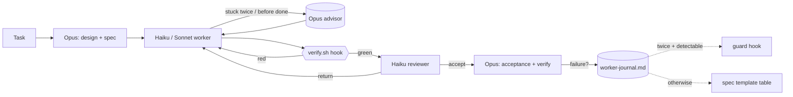

# claude-agent-team

**Opus plans. Haiku codes. Hooks verify.**

A Claude Code setup that works like a small dev team, plus a week of real logs of everything the agents got wrong.

[Русская версия](README.ru.md)

---

## Why

Viral "Claude Code tricks" are mostly vibes. This setup is the one I actually ship production software with: mobile apps, backends, CRMs, bots. It comes with the receipts: a journal of every worker failure and the rule each one turned into.

The core idea: **a rule in a prompt is a suggestion; a hook is a law.** Anything an agent gets wrong twice that can be caught by a command becomes a hook.

## The team

| Role | Model | Job |
|---|---|---|
| Orchestrator (main session) | Opus 5.5, effort high | Understands the task, designs, makes every decision, cuts work into steps of 1–5 files, writes the spec, accepts the result. Writes code only when the spec would be longer than the change. |
| `worker-haiku` | Haiku 5.5 | Default executor, ~80% of tasks. Exact specs, max 3–4 items each. |
| `worker-sonnet` | Sonnet 5.5, effort medium | Only where Haiku loops 2–3 times: races and lifecycle, security and permissions, complex interactive UI, hunting hangs, new client↔server protocols. One at a time. |
| `reviewer` | Haiku 5.5 | Read-only review after every worker that changed code. Doesn't trust the worker's report. |
| `reviewer-deep` | Sonnet 5.5 | Read-only review for security, auth, protocols, concurrency, data recovery. |
| Advisor | Opus 5.5 | Consulted *by workers*: after two failed attempts and before "done". See below. |



## What's enforced by hooks (not by hope)

| Hook | Event | What it does |
|---|---|---|
| `quick-check.sh` | after every Edit/Write | Syntax check for json/sh/py/php/rb. Broken file means the agent fixes it right away. |
| `verify-on-stop.sh` | Stop / SubagentStop | Runs the repo's `.claude/verify.sh` (fast checks, ≤2 min). Red: the agent **can't finish**. On the second attempt it lets the agent go so it can't loop, so the orchestrator always re-runs verify itself. |
| `guard-subagent.sh` | PreToolUse (Bash) | Blocks commands that workers kept running despite the spec, e.g. `simctl shutdown all` while other agents use the simulator. |
| `log-subagent.sh` | SubagentStop | One JSONL line per worker/reviewer run: outcome, duration, tool calls, advisor calls. `bin/worker-stats` turns it into a weekly summary. |

## The feedback loop

Every failure the reviewer or the orchestrator catches goes into `worker-journal.md` as a single line: what broke, why (spec / stack knowledge / complexity / tool), and what changed.

The pattern after one week was obvious: **almost every failure was "the spec didn't mention X"**. So the journal became a table in the spec template: *task class → mandatory spec sections*.

- Protocol adapter → unknown messages, plus cancel at every phase
- External API → its limits and error codes
- Client and server built in parallel → a shared contract fixture first
- Real-time status → "connection dropped mid-process"
- Money → integer minor units, fractional-percent test cases

See [worker-journal.md](worker-journal.md) for anonymized real examples.

## About `--advisor`

`claude --advisor opus` is real (the flag is hidden from `--help`; docs: [advisor](https://code.claude.com/docs/en/advisor)). Two things the hype skips:

1. **Claude decides when to call it.** You can't force "only before the plan, after repeated errors and before done". You can only ask for it in instructions.
2. **Each call re-reads the whole transcript, uncached, at Opus rates.** On a long Opus orchestrator session that adds up fast.

What *is* useful: **subagents inherit the advisor**, and Haiku 5.5 + Opus advisor is a valid pairing. A worker's transcript is short, so the advisor call is cheap. Here, workers call it after two failed attempts and before "done", reviewers call it before "accept" on risky code, and the main Opus session doesn't call it at all. Measure it with `worker-stats` and turn it off (`/advisor off`) if it doesn't pay.

("JEV routing micro-forks in milliseconds" from the same viral post doesn't exist.)

## Install

Requirements: Claude Code, `jq`, `python3`, `perl`, `git`.

Open Claude Code and paste the contents of [INSTALL.md](INSTALL.md). It backs up your settings, merges hooks into `settings.json` instead of overwriting it, tests every hook, and asks before touching anything that already exists.

Then for each repo you work in, add a fast `.claude/verify.sh` (templates in `verify-templates/`).

## Measure it

```bash
~/.claude/bin/worker-stats 7
```

You get runs per agent, outcomes, median duration, advisor calls and the share of reviews that ended in "accept". Compare it week over week with the journal.

## Cost notes

- The main cost is the Opus orchestrator, not the workers. Keep Opus reading summaries: reviewer reports instead of full diffs (except security or complex state), worker reports of 30 lines or less, cropped screenshots.
- A worker launch costs about 15–20k tokens of startup context. A task smaller than a few actions is cheaper for Opus to just do.
- Rework eats all the savings. A vague spec costs more than a long one.

## Files

```
agents/            worker-haiku, worker-sonnet, reviewer, reviewer-deep
skills/            worker-brief (spec template + task-class table), worker-review (acceptance checklist)
hooks/             quick-check, verify-on-stop, guard-subagent, log-subagent
bin/worker-stats   weekly summary
verify-templates/  .claude/verify.sh for node-ts, python, rust, go
CLAUDE-orchestration.md   the rules section for ~/.claude/CLAUDE.md
settings-snippet.json     hooks + advisorModel to merge
stack-skill-TEMPLATE.md   per-stack gotchas skill
worker-journal.md         journal template + real examples
INSTALL.md                one-paste installer prompt
```

## Author

Nikita Terekhin, [@sysrootix](https://x.com/sysrootix). I build apps, CRMs and bots this way, and I take client projects: DMs are open. Also building [Bandito](https://bandito.dev), your AI agent team on your own server.

## License

MIT
