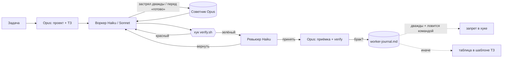

# claude-agent-team

**Opus планирует. Haiku пишет код. Хуки проверяют.**

Настройка Claude Code, которая работает как маленькая команда разработки, плюс журнал за неделю: всё, что агенты сделали не так.

[English version](README.md)

---

## Зачем

Вирусные «трюки для Claude Code» — в основном слова. Эта схема — та, на которой я реально выпускаю продакшен: мобильные приложения, бэкенды, CRM, ботов. И с доказательствами: журнал всех провалов воркеров и правило, которым стал каждый провал.

Главная идея: **правило в промпте — пожелание, хук — закон.** Всё, что агент сделал не так дважды и что ловится командой, становится хуком.

## Команда

| Роль | Модель | Что делает |
|---|---|---|
| Оркестратор (основная сессия) | Opus 5.5, effort high | Разбирается в задаче, проектирует, принимает все решения, режет работу на шаги по 1–5 файлов, пишет ТЗ, принимает результат. Код пишет сам, только если ТЗ вышло бы длиннее правки. |
| `worker-haiku` | Haiku 5.5 | Исполнитель по умолчанию, ~80% задач. Точное ТЗ, не больше 3–4 пунктов. |
| `worker-sonnet` | Sonnet 5.5, effort medium | Только там, где Haiku уходит на 2–3 круга: гонки и жизненный цикл, безопасность и права, сложный интерактивный UI, зависания, новые протоколы клиент↔сервер. Один одновременно. |
| `reviewer` | Haiku 5.5 | Ревью только на чтение после каждого воркера, менявшего код. Отчёту воркера не верит. |
| `reviewer-deep` | Sonnet 5.5 | Ревью безопасности, авторизации, протоколов, конкурентности, восстановления данных. |
| Советник | Opus 5.5 | К нему обращаются *воркеры*: после двух неудачных попыток и перед «готово». Подробности ниже. |



## Что держится хуками, а не надеждой

| Хук | Событие | Что делает |
|---|---|---|
| `quick-check.sh` | после каждого Edit/Write | Синтаксис json/sh/py/php/rb. Сломал файл — сразу чинит. |
| `verify-on-stop.sh` | Stop / SubagentStop | Прогоняет `.claude/verify.sh` репозитория (быстрые проверки, ≤2 мин). Красный — агент **не может закончить**. Со второго захода хук его выпускает, чтобы не зациклиться, поэтому оркестратор всегда перезапускает verify сам. |
| `guard-subagent.sh` | PreToolUse (Bash) | Блокирует команды, которые воркеры выполняли вопреки ТЗ, например `simctl shutdown all`, пока симулятором пользуются другие агенты. |
| `log-subagent.sh` | SubagentStop | Строка JSONL на каждый запуск воркера или ревьюера: исход, длительность, вызовы инструментов, вызовы советника. `bin/worker-stats` собирает из этого недельную сводку. |

## Петля обратной связи

Каждый брак, пойманный ревьюером или оркестратором, — одна строка в `worker-journal.md`: что сломалось, почему (ТЗ / знание стека / сложность / инструмент) и что поменяли.

Через неделю закономерность стала очевидной: **почти каждый провал — «в ТЗ не было X»**. Поэтому журнал превратился в таблицу в шаблоне ТЗ: *класс задачи → обязательные разделы*.

- Адаптер протокола → неизвестные сообщения и cancel на каждой фазе
- Внешний API → его лимиты и коды ошибок
- Клиент и сервер правятся параллельно → сначала общая фикстура контракта
- Статус в реальном времени → «связь пропала посреди процесса»
- Деньги → целые копейки и тесты с дробными процентами

Обезличенные реальные примеры — в [worker-journal.md](worker-journal.md).

## Про `--advisor`

`claude --advisor opus` существует: флаг скрыт из `--help`, документация — [advisor](https://code.claude.com/docs/en/advisor). Вирусные посты умалчивают о двух вещах:

1. **Когда звать советника, решает Claude.** Заставить его вмешиваться «только перед планом, после повторной ошибки и перед „готово“» нельзя. Можно только попросить в инструкциях.
2. **Каждый вызов заново читает весь транскрипт, без кеша, по цене Opus.** На длинной сессии Opus-оркестратора это быстро набегает.

Что *реально* полезно: **сабагенты наследуют советника**, и пара Haiku 5.5 + советник Opus допустима. Транскрипт воркера короткий, поэтому вызов советника дешёвый. Здесь воркеры зовут его после двух неудач и перед «готово», ревьюеры — перед «принять» по рискованному коду, а основная Opus-сессия не зовёт вообще. Замеряйте через `worker-stats`; не окупается — `/advisor off`.

«JEV, который маршрутизирует микро-форки за миллисекунды», из того же вирусного поста не существует.

## Установка

Нужны Claude Code, `jq`, `python3`, `perl`, `git`.

Откройте Claude Code и вставьте содержимое [INSTALL.md](INSTALL.md). Он сделает бэкап настроек, допишет хуки в `settings.json` (а не перезапишет его), проверит каждый хук и спросит, прежде чем трогать то, что у вас уже есть.

Потом в каждом рабочем репозитории заведите быстрый `.claude/verify.sh`. Шаблоны лежат в `verify-templates/`.

## Замеры

```bash
~/.claude/bin/worker-stats 7
```

Покажет запуски по агентам, исходы, медиану длительности, вызовы советника и долю ревью с вердиктом «принять». Сравнивайте неделю к неделе вместе с журналом.

## Про расходы

- Главная статья расходов — Opus-оркестратор, а не воркеры. Пусть Opus читает выжимки: отчёт ревьюера вместо всего diff (кроме безопасности и сложного состояния), отчёты воркеров до 30 строк, обрезанные скриншоты.
- Запуск воркера стоит примерно 15–20 тыс. токенов стартового контекста. Задачу меньше нескольких действий дешевле сделать самому Opus.
- Переделка съедает всю экономию. Расплывчатое ТЗ обходится дороже длинного.

## Автор

Никита Терехин, [@sysrootix](https://x.com/sysrootix). Так я делаю приложения, CRM и ботов и беру проекты на заказ — пишите в личку. Ещё делаю [Bandito](https://bandito.dev): команду AI-агентов на вашем собственном сервере.

## Лицензия

MIT
